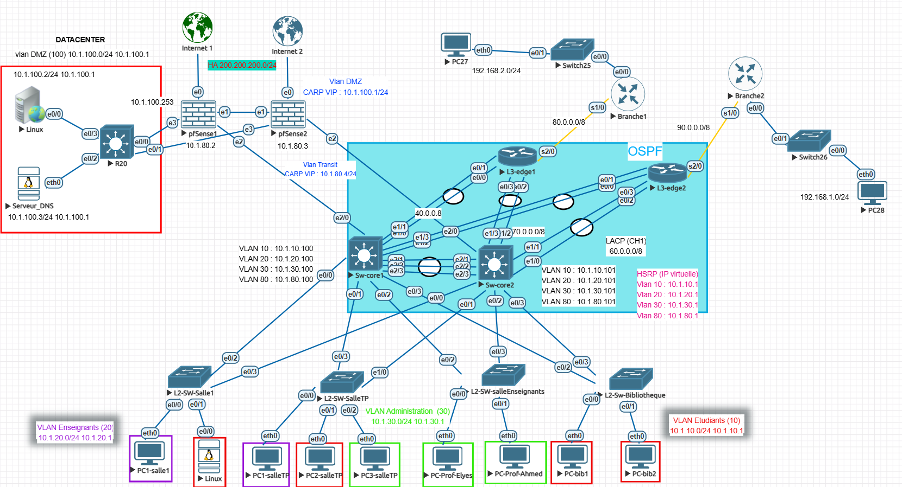

# 1. Topologie

## Lecture du schéma

| Zone | Équipements | Rôle |
|---|---|---|
| Accès | L2-SW-Salle1, L2-SW-SalleTP, L2-SW-salleEnseignants, L2-Sw-Bibliotheque | VLANs 10, 20, 30 ; chaque switch est relié aux **deux** cœurs |
| Cœur (OSPF) | Sw-core1, Sw-core2 | Routage inter-VLAN, HSRP en load-sharing, DHCP split-scope |
| Bordure | L3-edge1, L3-edge2 | Liens LACP vers les cœurs, liens série vers les branches |
| Branches | Branche1 (192.168.2.0/24), Branche2 (192.168.1.0/24) | Sites distants, reliés en 80.0.0.0/8 et 90.0.0.0/8 |
| Pare-feu | pfSense1, pfSense2 | HA CARP, sortie vers Internet 1 et 2 |
| DMZ | R20, Linux, Serveur_DNS | VLAN 100, 10.1.100.0/24 |

## Adresses virtuelles

| Fonction | Adresse |
|---|---|
| HSRP VLAN 10 / 20 / 30 / 80 | 10.1.10.1 / 10.1.20.1 / 10.1.30.1 / 10.1.80.1 |
| CARP transit (VLAN 80) | 10.1.80.4/24 |
| CARP DMZ (VLAN 100) | 10.1.100.1/24 |
| Synchronisation pfSense (pfsync) | 200.200.200.0/24 |
| Liaisons cœur ↔ edge | 40.0.0.0/8, 50.0.0.0/8, 60.0.0.0/8 (LACP CH1), 70.0.0.0/8 |

## Points à corriger sur le schéma
- [ ] L'étiquette `40.0.0.8` devrait être `40.0.0.0/8`
- [ ] Vérifier que les 4 liens EtherChannel (40, 50, 60, 70) sont tous légendés
